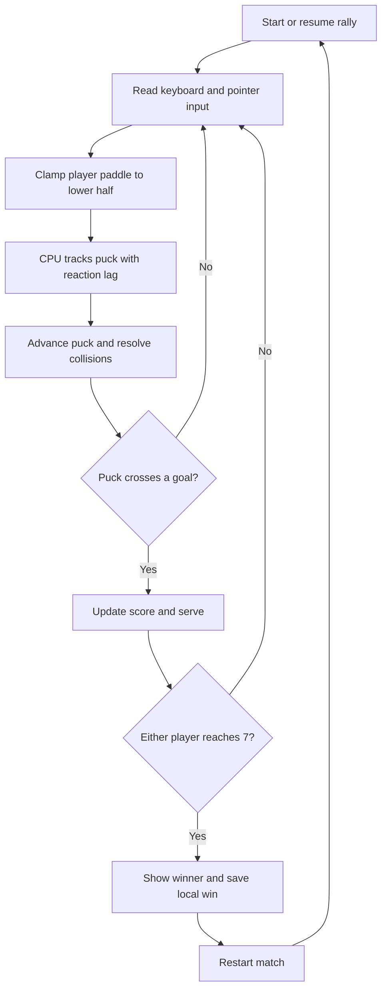

# Neon Rink

A fast, neon-lit air hockey game built with Vue 3, TypeScript, and Vite. Challenge the rink rival, keep your paddle on your side, and race to seven.

**Play:** [oscarmmi.github.io/air-hockey](https://oscarmmi.github.io/air-hockey/)

## How to play

- Drag with a mouse or touch to move your paddle in the lower half of the table.
- Use **← / →** or **A / D** to slide horizontally. The **↑ / ↓** arrows add vertical movement within your half.
- Score by sending the puck through the rival's goal. The first player to **7** wins.
- Press **R** or use **Restart Match** for a fresh game. Press **Escape** to pause or resume.
- Wins are saved locally in your browser. The sound toggle adds optional synthesized game tones.

## Run locally

```sh
npm install
npm run dev
```

Run the game-logic tests and production build with:

```sh
npm test
npm run build
```

## Game loop



## Built with

Vue 3 · TypeScript · Vite · Vitest · Canvas 2D
